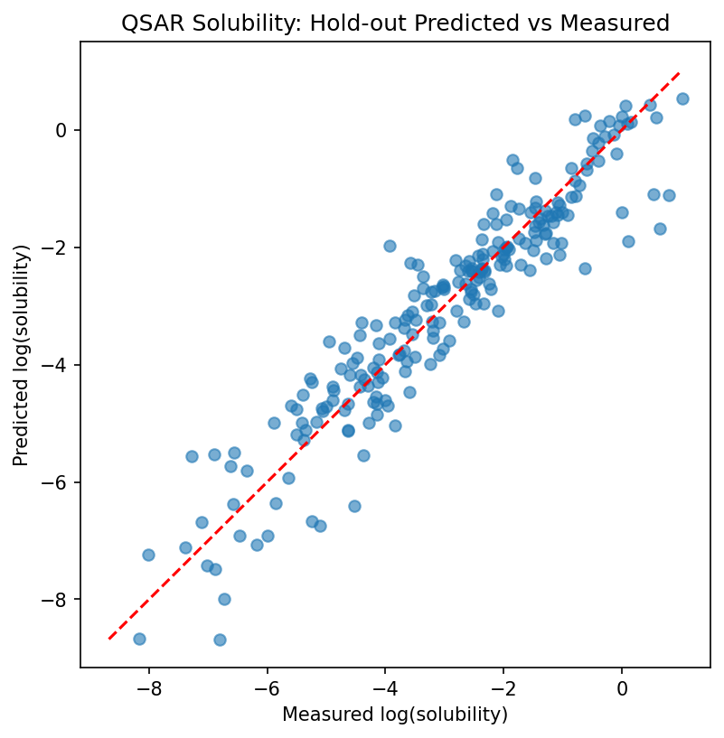

# QSAR Solubility Prediction

Predicting aqueous solubility (log mol/L) of organic compounds from RDKit molecular descriptors using a Random Forest regressor, trained on the ESOL (Delaney) dataset.

## Problem

Solubility is a critical property in drug discovery, since poorly soluble compounds often fail in development. This project predicts solubility directly from molecular structure.

## Dataset

The dataset contains 1,144 compounds from the ESOL collection, with SMILES strings and measured log solubility. Sixteen compounds appeared twice, so 32 rows were removed. Duplicates were dropped because they either had the same input with different measured values, or were distinct compounds sharing an identical SMILES (for example, stereoisomers and PCB isomers). The cleaned dataset contains 1,112 unique compounds. No salts or empty SMILES were found.

## Method

- Molecular descriptors were calculated for each compound with RDKit (217 descriptors).
- Feature selection kept 10 descriptors, chosen from feature importance and correlation groups.
- The data was split 80:20 into a development set and a hold-out set.
- A Random Forest regressor was tuned on the development set using GridSearchCV with 5-fold cross-validation.
- The best model was evaluated once on the hold-out set.

## Results

| Metric | Value |
| :--- | :--- |
| Dev CV R² (tuning) | 0.892 |
| Best parameters | max_depth=None, max_features=0.5, min_samples_leaf=1 |
| Hold-out RMSE | 0.669 |
| Hold-out R² | 0.880 |

The predicted values lie close to the diagonal across most of the range. The tightest agreement occurs between about −4 and −1 log(solubility). The largest errors are concentrated among highly soluble compounds (measured values between about 0 and +1), where the model underestimates solubility by roughly 2 log units.

## Limitations

- The dataset is small after cleaning (1,112 compounds), and the hold-out set contains only 223 compounds, so individual errors can noticeably change the metrics.
- Only RDKit descriptors are used. Crystal packing, melting point and 3D shape are not captured. For example, planar, rigid molecules such as anthraquinone are predicted to be more soluble than they are measured.
- Feature selection was performed on the full cleaned dataset, which may make the cross-validated scores slightly optimistic.

## Tools

Python, RDKit, Pandas, Scikit-learn, Matplotlib

## How to run

1. Open `QSAR_Solubility_Prediction.ipynb` in Google Colab.
2. Run all cells from the top. The first cell installs RDKit.
3. The ESOL dataset is loaded directly from a URL, so no data file is needed.

## Reference

Delaney, J. S. (2004). ESOL: Estimating Aqueous Solubility Directly from Molecular Structure. *Journal of Chemical Information and Computer Sciences*, 44(3), 1000–1005.
